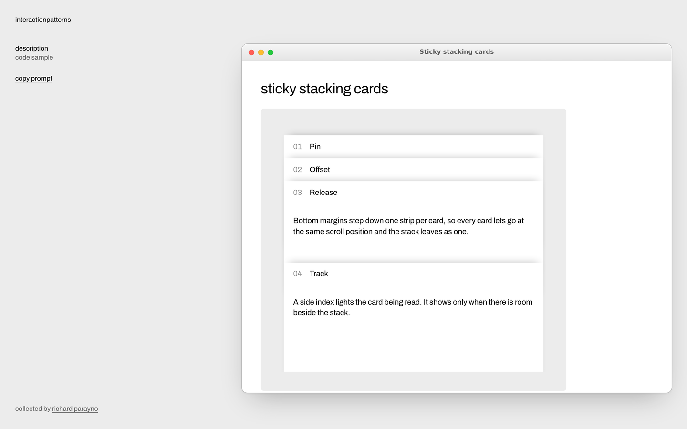

# Interaction Patterns

A personal library of interaction design patterns worth reusing. Each pattern
has a name, a screenshot, a live demo, sample code, and a copy-pastable prompt
for AI coding agents. Built as a static site with [Astro](https://astro.build/)
and deployed to Cloudflare Workers.



## Stack

- Astro 7 for pages, layouts, and static-site generation
- An Astro content collection for patterns, one folder per pattern
- Shiki (Astro's built-in `<Code>`) for sample-code highlighting
- Plain CSS: design tokens in `src/styles/global.css`, scoped styles per component
- Self-hosted OFL fonts: Archivo for text, Ioskeley Mono for code
- Bun for JavaScript dependencies and scripts
- `devenv` or mise (`.tool-versions`) for the project-local Bun toolchain
- Cloudflare Workers static assets for hosting

## Project structure

```text
.
├── docs/
│   └── screenshot.png            # README screenshot
├── public/                       # Static files copied directly into the build
├── src/
│   ├── assets/fonts/             # Archivo and Ioskeley Mono, each with OFL.txt and SOURCE.md
│   ├── components/
│   │   ├── PageGrid.astro        # Rail and main column
│   │   ├── PatternList.astro     # Index wheel picker; the centred pattern's screenshot and summary
│   │   ├── SoundToggle.astro     # Turns the wheel's tick sound on or off
│   │   ├── PatternHeader.astro   # Name, live demo, and summary atop the description view
│   │   ├── Window.astro          # macOS-style window holding a pattern's views
│   │   ├── WindowView.astro      # One view (description, code), shown via #id
│   │   ├── WindowNav.astro       # Text links that switch views
│   │   ├── Prompt.astro          # The agent prompt, shown verbatim in a copy block
│   │   ├── CopyBlock.astro       # Grey well with a label and a copy icon
│   │   ├── CopyButton.astro      # Copies an element's text to the clipboard
│   │   ├── Stage.astro           # Grey well the live demo runs in
│   │   └── Code.astro            # One sample file in a copy block
│   ├── content/
│   │   └── patterns/<slug>/      # One folder per pattern (see below)
│   ├── content.config.ts         # Pattern schema and loader
│   ├── data/
│   │   └── patterns.ts           # Joins each entry with its demo and code files
│   ├── layouts/
│   │   └── BaseLayout.astro      # Document shell, page metadata, site header and footer
│   ├── pages/
│   │   ├── index.astro           # Pattern index
│   │   ├── patterns/[slug].astro # Pattern page template
│   │   └── 404.astro
│   └── styles/
│       ├── global.css            # Tokens, reset, page grid
│       └── fonts.css
├── astro.config.mjs
├── bun.lock
├── bunfig.toml                   # Bun install policy
├── devenv.nix
├── package.json
└── wrangler.jsonc                # Cloudflare Worker and static assets configuration
```

## Local development

```sh
devenv shell   # or: mise install
bun install
astro dev --background
```

The site is available at <http://localhost:4321>. Manage the background server
with `astro dev status`, `astro dev logs`, and `astro dev stop`.

| Command | Purpose |
| --- | --- |
| `bun run build` | Generate the production site in `dist/` |
| `bun run check` | Type-check Astro and TypeScript files |
| `bun run preview` | Preview the production build locally |
| `bun run build && bunx wrangler dev` | Serve the build the way Cloudflare does |

## Adding a pattern

Create a folder under `src/content/patterns/`. The folder name becomes the URL:

```text
src/content/patterns/sticky-stacking-cards/ -> /patterns/sticky-stacking-cards/
├── index.md          # Name, summary, index thumbnail; the body is the agent prompt
├── Demo.astro        # The live demo shown on the page
└── screenshot.png    # Index thumbnail; any image format Astro supports
```

`index.md`:

```markdown
---
name: Sticky stacking cards
summary: One sentence shown on the index and in page metadata.
screenshot: ./screenshot.png
added: 2026-11-09
code:              # optional; defaults to [Demo.astro]
  - Demo.astro
  - stack.css
---

The agent prompt, written in Markdown. It is shown verbatim on the page and
the copy button copies exactly this text.
```

- **Prompt**: the Markdown body of `index.md`, without the frontmatter.
- **Live demo**: `Demo.astro` is rendered in the description, between the
  name and the summary. Its `<style>` is scoped by Astro and its `<script>` is
  bundled once, so write scripts that set up every matching element
  (`querySelectorAll`). The demo runs in a grey (`#ececec`) well at least
  18rem tall (12rem on phones) that uses `contain: layout`, so fixed-position
  UI stays inside it, and resets font size and casing, so a demo starts from
  1rem and brings its own styles and surface.
- **Name and summary**: write them in sentence case. The site lowercases its
  own text through the `--case` token in `src/styles/global.css`; prompts,
  code, demos, and file names keep their casing.
- **Sample code**: the files listed in `code`, read from the pattern folder
  and highlighted by extension. Showing `Demo.astro` itself keeps the code and
  the demo in sync; add other files (`.html`, `.css`, `.ts`, `.tsx`, …) for
  framework-specific versions.
- **Screenshot**: the thumbnail beside the pattern on the index wheel,
  optimized at build time with `astro:assets`. Pattern pages show the live
  demo instead.

The schema is in `src/content.config.ts`; a missing field, a missing
`Demo.astro`, or a `code` entry that does not exist fails the build with a
message naming the pattern. Patterns are listed newest `added` first.

## Deployment

The site is deployed as a static-assets-only Cloudflare Worker named
`interactionpatterns`, configured in `wrangler.jsonc`. To deploy with Workers
Builds, connect this repository in the Cloudflare dashboard with:

| Setting | Value |
| --- | --- |
| Build command | `bun run build` |
| Deploy command (`main`) | `npx wrangler deploy` |
| Preview command (other branches) | `npx wrangler preview` |
| Build cache | Enabled |

Until the site has its own domain, `site` in `astro.config.mjs` and the sitemap
URL in `public/robots.txt` point at
`https://interactionpatterns.mgrp.workers.dev`; update both when a custom
domain is attached.
